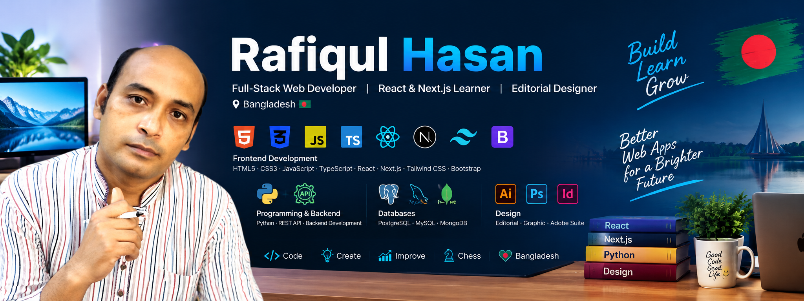

<p align="center">
  
</p>

# Hi, I'm Rafiqul Hasan 👋

### Full-Stack Web Developer | React & Next.js Learner | Editorial Designer

I’m a passionate developer from **Bangladesh 🇧🇩**, focused on building modern, responsive and user-friendly web applications.

I enjoy working with **React, Next.js, TypeScript, JavaScript, Python and databases**, while also bringing my experience in **Editorial & Graphic Design** into my digital projects.

---

## 🚀 About Me

* 💻 Currently focusing on **React.js & Next.js**
* ⚡ Building modern web applications with **TypeScript & JavaScript**
* 🐍 Exploring **Python & Backend Development**
* 🗄️ Working with **PostgreSQL, MySQL & MongoDB**
* 🎨 Experienced in **Editorial & Graphic Design**
* 📚 Continuously learning new technologies
* ♟️ Chess enthusiast
* 🇧🇩 Based in Bangladesh

---

## 🛠️ Technologies & Skills

### 🌐 Frontend Development

<p>
  
</p>

**HTML5 • CSS3 • JavaScript • TypeScript • React.js • Next.js • Tailwind CSS • Bootstrap**

### 🐍 Programming & Backend

<p>
  
</p>

**Python • REST API • Backend Development**

### 🗄️ Databases

<p>
  
</p>

**PostgreSQL • MySQL • MongoDB**

### 🎨 Design

**Editorial Design • Graphic Design • Adobe Illustrator • Adobe Photoshop • Adobe InDesign**

---

## 💻 What I’m Working On

🔹 Modern web applications with **Next.js & React**

🔹 Responsive UI using **Tailwind CSS & Bootstrap**

🔹 REST API and backend development with **Python**

🔹 Database-driven applications using **PostgreSQL, MySQL & MongoDB**

🔹 Personal projects combining **Development + Design**

---

## 📌 Featured Skills

```text
Frontend        → React.js | Next.js | JavaScript | TypeScript
Styling         → Tailwind CSS | Bootstrap | CSS
Backend         → Python | REST API
Database        → PostgreSQL | MySQL | MongoDB
Design          → Editorial Design | Graphic Design
Tools           → Git | GitHub | VS Code
```

---

## 📊 GitHub Stats

<p align="center">
  
</p>

---

## 🌱 Currently Learning

```text
Next.js
   ↓
Advanced React
   ↓
TypeScript
   ↓
Python Backend
   ↓
REST API
   ↓
Database & Backend Architecture
```

---

## 🎯 My Goal

> To become a professional full-stack web developer by continuously improving my development, problem-solving and design skills.

---

## 🤝 Let's Connect

I'm always interested in learning, collaborating and working on interesting projects.

**Thanks for visiting my profile! ❤️**

⭐ Feel free to explore my repositories and projects.
